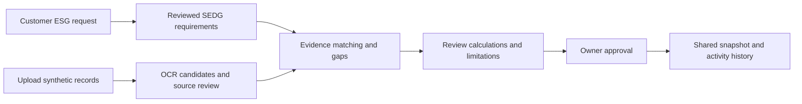
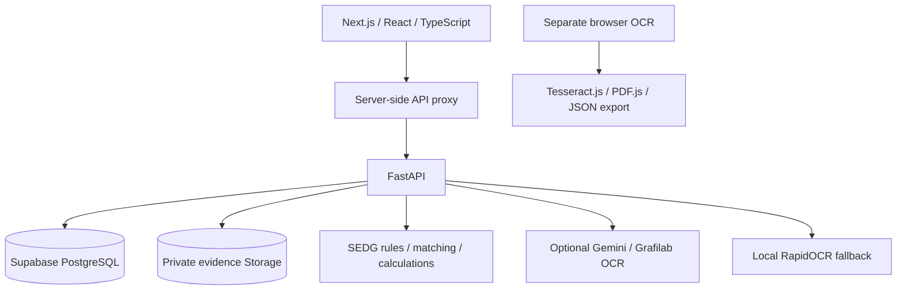

<p align="center"></p>

# ESG Passport

> Turn Malaysian SMEs' monthly records into traceable, human-reviewed ESG questionnaire responses.

## Team Information

| Field | Details |
| --- | --- |
| Team Name | Kopi-Paste Coders |
| Team Domain | Domain 2 — Orbyte Smart SME Challenge: Less Busywork, Better Business |
| SDG Track | SDG 8 — Decent Work and Economic Growth; targets 8.2 and 8.3. Secondary enabling link: SDG 12.6. |
| Team Leader | Lee Boon Yew |
| University | Tunku Abdul Rahman University of Management and Technology (TARUMT) |
| Number of Members | 4 |

## Links

| Resource | Link / status |
| --- | --- |
| GitHub Repository | [ESG Passport](https://github.com/nestchao/ESG-Passport) — currently private; authorised access required. |
| Live Demo | [Shared fictional workspace](https://esg-passport.replit.app/) |
| Browser Demo | [Browser-only fictional demo](https://esg-passport-web.onrender.com/demo) |
| Browser OCR | [Local browser OCR tool](https://esg-passport-web.onrender.com/ocr) |
| Replit Project / Proof of Use | To confirm; no verified project/history link supplied. |
| RunPod Endpoint / Proof of Use | No deployed endpoint established in this repository. |
| Slide Deck | To confirm |
| Demo Video | To confirm |

Links are configured demonstration addresses, not a guarantee of uptime. Free hosting can require a cold start.

## Overview

### Problem

An SME administrator receives another customer ESG questionnaire. The requested information is scattered across utility bills, fuel receipts, waste tickets and spreadsheets. Re-entering it is repetitive, and an apparently complete response may still use the wrong unit, reporting period or evidence boundary.

ESG Passport addresses one recurring task: **prepare a customer ESG response from monthly records while preserving evidence, uncertainty and owner control**. It is proposed as a reusable sustainability module for Orbyte's shared business hub. There is no live Orbyte connector or production platform integration.

Malaysia's [National Sustainability Reporting Framework (NSRF)](https://www.sc.com.my/nsrf) uses IFRS S1 and IFRS S2 as baseline disclosure standards, with phased implementation for applicable companies. This does not impose identical obligations on every ordinary SME. Our product hypothesis is that SMEs supplying larger businesses need a practical way to organise information requested by their customers.

The core catalogue references CMM's [Simplified ESG Disclosure Guide, Version 2](https://sedg.capitalmarketsmalaysia.com/wp-content/uploads/2025/07/SEDG-v2.pdf). Mapping to a disclosure identifies a data requirement; it does not establish NSRF compliance or replace a calculation methodology.

### Solution

ESG Passport combines document OCR, structured activity review, SEDG requirement mapping and evidence matching in an owner-approved preparation workflow. AI helps transcribe messy inputs; deterministic rules check supported metrics, units and evidence boundaries. People correct suggestions and decide what can be shared.

**Competition demonstrations use team-created synthetic records only.** This is a preparation prototype, not a certification service, statutory filing tool, payment processor or source of legal/financial advice.

### Key Features

- **Document review:** retain original evidence and correct proposed quantities, units and dates.
- **Question-to-SEDG mapping:** inspect English/Malay rule suggestions and confirm requirements.
- **Evidence matching:** show relevant sources, reporting-period coverage and unresolved gaps.
- **Controlled preparation:** distinguish activity data from emissions calculations and review factor assumptions.
- **Owner approval and history:** approve selected evidence for a shareable snapshot with an activity record.

### Tech Stack

| Layer | Technology |
| --- | --- |
| Frontend | Next.js, React, TypeScript, Tailwind CSS |
| Backend | Python 3.12, FastAPI, Pydantic, SQLAlchemy, Alembic |
| Database / Files | Supabase PostgreSQL and private object storage |
| AI / OCR | Optional Gemini and Grafilab; local CPU RapidOCR; separate Tesseract.js/PDF.js browser tool |
| Hosting | Render frontend/API services |
| Replit / RunPod | Usage evidence must be confirmed; not represented as verified hosting or GPU execution |

### Core Workflow



| Stage | System assistance | Human decision |
| --- | --- | --- |
| 1. Intake | Retain originals; propose quantity, unit, dates and source context. | Correct extraction and confirm the activity category. |
| 2. Requirement form | Suggest supported SEDG codes using English/Malay rules and keyword cues. | Confirm metric, period, unit and boundary. |
| 3. Matching | Check evidence relevance, coverage and compatible units; show gaps. | Decide what a source proves and resolve missing information. |
| 4. Preparation | Calculate supported metrics and preserve unresolved issues. | Review assumptions, select evidence and approve sharing. |

OCR output does not automatically become a verified measurement. Changed records can invalidate drafts; approval does not authorise silently rewriting a historical snapshot.

---

## Judge Walkthrough

| Route | Behaviour | Data boundary |
| --- | --- | --- |
| `/` and `/live` | Shared monthly workspace, records, customer requests and approvals. | Backend and Supabase; remote OCR only when configured. |
| `/demo` | Guided fictional browser demo. | Browser state; no Supabase or remote AI calls. |
| `/ocr` | Tesseract.js/PDF.js OCR and JSON review export. | Browser processing; export is not automatically imported into saved workspace records. |

The hosted live workspace is **passwordless, shared and fictional**. Visitors can edit or delete test records subject to backend checks. Owner/clerk/customer identities are simulated. Do not upload private or real company records.

### Demo Steps

1. Open the workspace and select a reporting month.
2. Inspect an existing record or upload a team-created fixture from `src/ai/synthetic_dataset/`.
3. Compare proposed values with the source. Correct quantity, unit, dates and category, then confirm the record.
4. Inspect the monthly ESG profile and its missing-factor, proxy or coverage limitations.
5. Create a customer question about electricity consumption or Scope 2 emissions for that period. Review the code and evidence match.
6. Switch to the simulated owner role, review gaps and selected evidence, and approve the shareable snapshot.
7. Inspect the shared result and activity history. Show where human confirmation and approval occurred.

---

## Project Structure

```text
.
├── docs/                         # Deployment guide and assets
├── runpod/                       # Resource notes; not execution evidence
├── src/
│   ├── frontend/                 # Web interface, demo and browser OCR
│   ├── backend/                  # API, migrations, storage and tests
│   └── ai/
│       ├── workflow/             # Evidence, mapping, matching and preparation
│       ├── comparison/           # Provider comparison documentation
│       ├── synthetic_generator/  # Offline generator
│       └── synthetic_dataset/    # Fictional images, labels and provenance
├── submission/                   # Competition materials
├── tests/                        # Workflow and generator tests
├── .env.example                  # Safe configuration template
├── .replit                       # Starter placeholder
├── render.yaml                   # Hosting configuration
├── requirements.txt              # Backend/workflow dependencies
└── LICENSE                       # Apache-2.0
```

Private research, evaluation records and environments live under ignored `src/ai/.local/`; they are not included in a fresh clone.

---

## Architecture



---

## How to Run

Requirements: **Python 3.12, uv, Node.js 22, npm**, and a disposable Supabase project for the full application. The browser-only `/demo` does not require Supabase or AI keys.

### 1. Configure the root environment

From repository root, PowerShell:

```powershell
if (!(Test-Path .env)) { Copy-Item .env.example .env }
```

Fill in your own server credentials:

```dotenv
DATABASE_URL=<Supabase Postgres connection string>
SUPABASE_URL=<project URL>
SUPABASE_SERVER_KEY=<server-only secret>
SUPABASE_STORAGE_BUCKET=esg-evidence
FRONTEND_ORIGIN=http://127.0.0.1:3000
NEXT_PUBLIC_API_URL=http://127.0.0.1:8001
ESG_OCR_MODE=offline
ALLOW_SAMPLE_RESET=false
```

Do not commit `.env` or expose private credentials through `NEXT_PUBLIC_*`. Process environment overrides can apply; restart affected services after changes.

### 2. Create the application environment

```powershell
uv venv --python 3.12 src/backend/.venv
uv pip install --python src/backend/.venv/Scripts/python.exe -r requirements.txt
```

For Linux/WSL use the corresponding explicit `.venv/bin/python3` path. The generator has separate requirements because its Pillow version differs from the backend; use a separate generator environment.

### 3. Initialise a disposable synthetic workspace

The following commands mutate the configured database/storage. Check that `.env` selects the intended test project first. From `src/backend`:

```powershell
.\.venv\Scripts\python.exe -m alembic upgrade head
.\.venv\Scripts\python.exe -m esg_backend.cli init-storage
.\.venv\Scripts\python.exe -m esg_backend.cli seed
.\.venv\Scripts\python.exe -m esg_backend.cli check
.\.venv\Scripts\python.exe -m uvicorn esg_backend.app:app --host 127.0.0.1 --port 8001
```

Startup does not automatically migrate, seed or initialise Storage. Seeding creates a fictional company and does not reset an existing workspace. See [backend setup](src/backend/README.md) for migrations, private bucket and browser-access checks. API docs are at `http://127.0.0.1:8001/docs` while running.

### 4. Start the frontend

In another terminal, from `src/frontend`:

```powershell
npm ci
npm run dev
```

Open `http://127.0.0.1:3000`, or `/demo` for browser-only fixtures. Remote OCR is optional and requires permitted document transmission and server-side credentials.

### Deployment

Follow [docs/DEPLOY-RENDER.md](docs/DEPLOY-RENDER.md) and `render.yaml`. Frontend/API deploy independently; local `.env` is not uploaded automatically. Hosted protection uses `DEMO_ACCESS_ENABLED`, a server-only `BACKEND_SHARED_KEY` and configured origins. Current Blueprint public live mode is passwordless; this is not production authentication.

The `.replit` file is a **starter placeholder**, not a working application launch configuration or proof of competition-required Replit use. Render deployment does not replace that evidence.

---

## Run Tests

Frontend, from `src/frontend`:

```powershell
npm test
npm run typecheck
npm run build
```

Backend, from `src/backend`:

```powershell
uv pip install --python .venv/Scripts/python.exe -r requirements-dev.txt
.\.venv\Scripts\python.exe -m pytest tests -q --basetemp=./.pytest-tmp
```

Workflow tests, from repository root with the approved backend/workflow environment:

```powershell
$env:PYTHONPATH = "src"
.\src\backend\.venv\Scripts\python.exe -m unittest discover -s tests -v
```

Tests requiring generator dependencies need its separate environment. Tests use synthetic fixtures and isolated/fake services where applicable. They do not establish live provider quotas, Supabase permissions, deployment uptime or legal compliance. The full application suite was not rerun for this documentation update.

For manual acceptance, use a fictional bill, correct OCR, confirm the record, map a request, inspect gaps, approve as simulated owner and inspect the shared outcome/activity history. Exercise archive/restore and stale-version conflicts on disposable records. Permanent deletion requires owner confirmation and is blocked for records referenced by approved shares or historical declarations.

---

## AI, Evidence & Calculation

### OCR

Hosted uploads follow `Next.js proxy → FastAPI → OCR provider → conservative parser → human review`. Parsed values are candidates, not assured disclosures. Supported backend inputs include PNG/JPEG and supported single-page PDFs, subject to validation and upload limits.

| `ESG_OCR_MODE` | Behaviour |
| --- | --- |
| `offline` | CPU RapidOCR; default, no remote document transmission. |
| `gemini` | Configured Gemini transcription with offline recovery. |
| `grafilab` | Configured Grafilab transcription with offline recovery. |
| `gemini_grafilab_fallback` | Gemini, then Grafilab on failure, then local OCR. |
| `compare` | Two configured Gemini models; candidates compared for review. |
| `compare_grafilab` | Gemini and Grafilab candidates compared for review. |

See [.env.example](.env.example) and the [backend guide](src/backend/README.md). `ESG_COMPARE_MODELS` determines Gemini selection where configured; Grafilab uses `GRAFILAB_OCR_MODEL`. Verify account access, current model IDs, quotas and prices before enabling calls. Free-tier availability and daily resets are not a service guarantee.

A separate [persistent OCR router](src/ai/workflow/ocr/README.md) implements job caching, cooldowns and budget reservations. **It is not wired into the hosted upload endpoint.** Its `OCR_FALLBACK_MODE` and allowance ledger must not be mistaken for controls already enforced by the hosted `ESG_OCR_MODE` adapter.

### Question → SEDG → evidence

Questionnaire mapping uses **deterministic English/Malay rules**, not a remote LLM. Its supported environmental core is E1.1, E1.2, E2.1, E3.1 and E4.1. Ambiguous and unsupported questions need manual handling; this is not complete SEDG coverage. The application separately supports manual social/governance declarations.

| Code | Requirement | Measurement boundary |
| --- | --- | --- |
| E1.1 | Scope 1 emissions, tCO2e | Consumed fuel under the relevant organisational boundary plus reviewed emission factors. Purchase alone is insufficient. |
| E1.2 | Scope 2 emissions, tCO2e | Purchased electricity plus applicable reviewed grid factor and boundary. |
| E2.1 | Energy consumption, kWh/MWh/GJ | Electricity provides energy evidence; fuel litres require a fuel-specific energy factor. |
| E3.1 | Water withdrawal, L/m3 | Withdrawal, consumption and discharge are different metrics. |
| E4.1 | Waste quantities, t/kg | Transfer weight does not prove generation in the same period or completed treatment. |

One electricity bill can support E2.1 and E1.2: energy and emissions are different measurements. Fuel can support energy and Scope 1 calculations after consumption and boundary checks.

Confidence, evidence strength and review urgency are different. A logo does not authenticate a source. Reviewed staff declarations remain self-declared. Unknown values remain missing, rather than becoming zero.

### Conversion and calculation

- Backend water: `m3 × 1000 = L`; waste: `kg ÷ 1000 = t`.
- The AI unit catalogue supports Wh/kWh/MWh/MJ/GJ conversion. Website electricity activity input currently accepts kWh.
- The website calculator uses configured fuel-specific energy/emissions factors, with explicit missing-factor and proxy limitations.
- The standalone preparation engine supports guarded location-based Scope 2: `kWh × kgCO2e/kWh ÷ 1000 = tCO2e`, with reviewed factor, year, region, boundary and coverage metadata. Scope 1 and fuel-to-energy calculation remain unresolved in that engine.
- Website and standalone calculation paths are not fully equivalent. There is **no live official CMM SEDG calculator integration**, automatic certification or complete verified GHG inventory.

---

## Evaluation Results

On **24 October 2026**, one tester completed **10 eligible paired trials**. Each block had four synthetic documents, five questions and 40 scored fields across data entry, mapping and matching. Assistance used **CPU RapidOCR and deterministic rules, not Gemini or Grafilab**. Recorded elapsed time includes processing and human correction, but not a complete production approval/export journey.

| Trial | Manual (s) | Assisted (s) | Time reduction | Manual correct | Assisted correct |
| --- | ---: | ---: | ---: | ---: | ---: |
| 1 | 311.51 | 183.41 | 41.1% | 29/40 | 37/40 |
| 2 | 176.71 | 173.09 | 2.0% | 36/40 | 36/40 |
| 3 | 153.87 | 69.15 | 55.1% | 38/40 | 39/40 |
| 4 | 139.82 | 75.56 | 46.0% | 40/40 | 40/40 |
| 5 | 138.89 | 64.64 | 53.5% | 40/40 | 40/40 |
| 6 | 149.57 | 79.83 | 46.6% | 40/40 | 40/40 |
| 7 | 161.75 | 55.83 | 65.5% | 38/40 | 40/40 |
| 8 | 172.15 | 62.02 | 64.0% | 39/40 | 40/40 |
| 9 | 139.89 | 61.16 | 56.3% | 39/40 | 40/40 |
| 10 | 133.03 | 41.39 | 68.9% | 39/40 | 40/40 |

| Trials | Pairs | Mean manual (s) | Mean assisted (s) | Reduction in total time |
| --- | ---: | ---: | ---: | ---: |
| 1–10 | 10 | 167.72 | 86.61 | 48.4% |

Across observed tasks: **1,677.18 s manual versus 866.08 s assisted**, or **48.4% less total time**; **94.5% (378/400)** versus **98.0% (392/400)** correct fields against the provisional key. Reduction is `(manual − assisted) / manual × 100`, using unrounded times. This differs from the median of paired reductions.

**Limits:** one tester, reused packs, answer feedback, changed layouts/wording across versions and provisional author-assigned labels. These are not independent participants or representative SME validation. The combined percentage is descriptive, not a controlled population effect. Incomplete/interrupted sessions were omitted; one accidental incomplete pair was explicitly excluded on the tester's request and retained in the audit record. Exclusion can bias the result and is disclosed.

Local raw sessions, exclusions, CSV, chart and input hashes are retained under `src/ai/.local/design/human-trial-results/`, not distributed with this repository. These figures cannot be independently reproduced from the public clone alone. An anonymised judge-facing evidence bundle and independent label review remain follow-up work.

Next evaluation target: **at least 30% lower median preparation time without lower reviewed accuracy**, tested with representative users, unseen matched tasks and an approval step. The present pilot does not establish this broader target or any direct CO2, energy or waste reduction.

---

## Data, Privacy & Security

The [dataset](src/ai/synthetic_dataset/README.md) contains **360 PNGs and 360 annotations from 120 fictional base records**, across electricity, water, fuel and waste. Clean/scan/photo variants stay grouped by base in candidate splits. Labels describe intended content; visibility and independent validation remain necessary. The [offline generator](src/ai/synthetic_generator/README.md) documents configuration and provenance. Supplemental fictional staff registers are self-declarations, not corroborated evidence.

Domain 2 requires **team-created synthetic data only**. Public-dataset licences do not override that restriction. Real reference records, customer data and credentials are not competition fixtures. Third-party fonts/reference materials retain their own rights.

Current safeguards include backend-only secrets, private evidence storage, review/approval checks and activity history. Public live mode remains shared; roles are simulated; hashes are not proof of identity. Privileged writers can alter stored information. Enabling remote OCR transmits documents to the selected provider. Browser-local OCR can still download code/models; it is not a promise of air-gapped operation.

A real deployment must address Malaysia's [seven personal data protection principles](https://www.perpaduan.gov.my/index.php/en/services/other-services/e-participation/personal-data-protection): general processing, notice/choice, disclosure, security, retention, integrity and access. Proposed controls include purpose-specific notices, minimal collection, individual authentication/tenant isolation, access/correction handling, retention/deletion policies, processor and cross-border transfer review, and incident response. Applicability and current obligations require deployment-specific review. No certified PDPA compliance is claimed.

---

## Competition Alignment

Based on the supplied **Domain 2 brief, PDF pages 4–9**, and competition handbooks. This is project alignment, not organiser approval.

| Requirement | Project evidence / boundary |
| --- | --- |
| One recurring SME problem | Preparing customer ESG responses from fragmented records. |
| Automated journey | Request → records → OCR/rules → review → owner approval → shared outcome/history. |
| Accuracy and ease of learning | Source review, unit/period checks and gaps; internal pilot is not independent SME validation. |
| People in control | Simulated roles, record confirmation and owner approval. |
| Orbyte fit/reuse | Proposed sustainability module using shared identity, evidence and notification interfaces; no live connector. |
| Business benefit/SDG | Preparation time and reviewed accuracy; SDG 8.2/8.3, enabling link to 12.6. |
| Synthetic-only boundary | Fictional team-created fixtures; no real personal/customer/company records in demonstrations. |
| Out-of-scope actions | No real payments, statutory filings, certification or professional advice. |

The preliminary rubric weights **Innovation & Creativity 30%, Problem–Solution Fit 25%, Feasibility 25%, Clarity 20%**. Optional features are not scored separately. The working reviewed journey takes priority over the number of compared models.

### SDG and Product Direction

The domain identifies **SDG 8.2**, productivity through technological upgrading/innovation, and **8.3**, support for entrepreneurship and SME growth. **12.6** is a secondary enabling link through sustainability information preparation. Reporting speed does not establish environmental savings.

A proposed business direction is an SME subscription or partner-distributed Orbyte module, with remote-OCR usage limits and reusable evidence/request interfaces. Pricing, willingness to pay and customer demand are not validated; the tester pilot is not a substitute for customer research.

---

## How We Use Replit

**Competition requirement:** the supplied Participant Handbook requires Replit as part of the solution and actual project/use evidence in the Technical & Tools Declaration.

**Current documentation status:** the team-provided [live demo](https://esg-passport.replit.app/) points to Replit; the separate browser demo and browser OCR links point to Render. The repository's `.replit` remains a starter placeholder. Add the team's project/history or permitted proof-of-use evidence to the Technical & Tools Declaration before presenting the requirement as complete.

## How We Use RunPod

The supplied Handbook requires RunPod for GPU-requiring work. This project's recorded human pilot used **local CPU RapidOCR**, with no RunPod GPU execution. The `runpod/` directory is not proof of a running endpoint.

Optional Gemini/Grafilab calls use hosted APIs. The team has stated this use is valid; retain any supporting organiser clarification. No RunPod handler, endpoint, usage screenshot or official hosted-API exemption is invented here. If GPU work is performed, use the required platform and supply the applicable GPU type, runtime and Pod ID/serverless endpoint evidence.

## Challenges & Learnings

- **Similar numbers mean different things:** net waste weight must be separated from gross/tare, bill charges from energy, and fuel purchases from consumption. Conservative parsing and source review expose these distinctions.
- **Mapping is not answering:** a SEDG code identifies a requirement; calculation factors, reporting boundaries and evidence can still be missing.
- **Provider availability varies:** OCR needs an offline/manual recovery path. The hosted adapter and separate persistent router have different integration status.
- **Speed needs a quality check:** actual paired timings were collected with field accuracy. Repeated packs and answer feedback introduced learning, so the results are exploratory.
- **A readable document is not verified evidence:** source strength, extraction confidence and review urgency must be treated separately.

## Future Improvements

- Independently validate labels and evaluate unseen tasks with representative SME users.
- Unify website and standalone preparation calculation semantics.
- Improve questionnaire paraphrase coverage and estimated-reading handling.
- Verify hosted timeout/fallback behaviour and integrate persistent routing controls.
- Add production authentication, tenant isolation and privacy/retention controls.
- Validate the proposed Orbyte connector and business model with partners/users.
- Publish an anonymised evaluation evidence bundle for independent review.

## Team

| Name | Role | GitHub |
| --- | --- | --- |
| Imam Mahdi Ali Ang Attuko | Project Lead: Repo, integration, deployment, and submission | [@nestchao](https://github.com/nestchao) |
| Lee Boon Yew | Software Lead: UI, modules, and backend | [@boon-boon](https://github.com/boon-boon) |
| Wee Lik Hui | AI Lead: LLM, AI integration, and data | [@Calaweh](https://github.com/Calaweh) |
| Yap Li Yang | Researcher & Pitcher: ESG Scope and the pitch | [@yapliyang](https://github.com/yapliyang) |

## Submission Checklist

- [/] Confirm team name, members, leader, university and role allocation.
- [/] Add final slide deck and demo video links.
- [/] Provide actual Replit use evidence and project access.
- [-] Confirm RunPod applicability/hosted-API clarification and provide usage evidence where applicable.
- [/] Complete the official proposal and Technical & Tools Declaration.
- [/] Disclose AI assistance, providers/models, libraries, synthetic generation and external references.
- [/] Verify judge access, live workflow and setup instructions.
- [/] Use only team-created synthetic demonstration data and check secrets are absent.
- [/] Preserve genuine development history, notices and the applicable submission freeze.

This checklist records outstanding verification, not a claim that requirements are fulfilled. Check current organiser announcements and official templates before submitting.

---

## References

- [CMM SEDG V2](https://sedg.capitalmarketsmalaysia.com/wp-content/uploads/2025/07/SEDG-v2.pdf)
- [Securities Commission Malaysia: NSRF](https://www.sc.com.my/nsrf)
- [Ministry of National Unity: personal data protection principles](https://www.perpaduan.gov.my/index.php/en/services/other-services/e-participation/personal-data-protection)
- [Backend setup and record lifecycle](src/backend/README.md)
- [Frontend routes](src/frontend/README.md)
- [Reviewed SEDG workflow](src/ai/workflow/README.md)
- [OCR router boundaries](src/ai/workflow/ocr/README.md)
- [Provider comparison research](src/ai/comparison/README.md)
- [Dataset and provenance](src/ai/synthetic_dataset/README.md)
- [Synthetic generator](src/ai/synthetic_generator/README.md)

---

## License

Original project code and team-created synthetic contributions use [Apache License 2.0](LICENSE). Third-party components and referenced materials retain their own licences/notices. No endorsement by CMM, SC, Orbyte or the organisers is implied.
