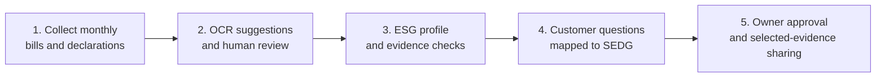
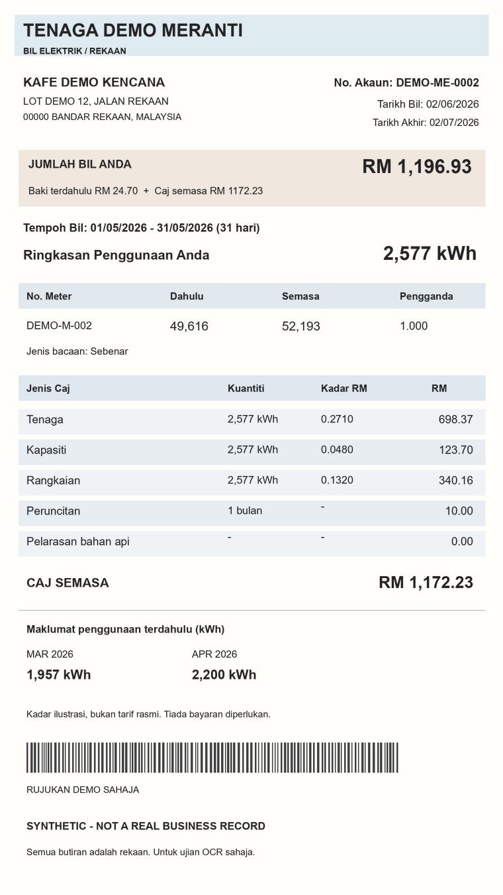
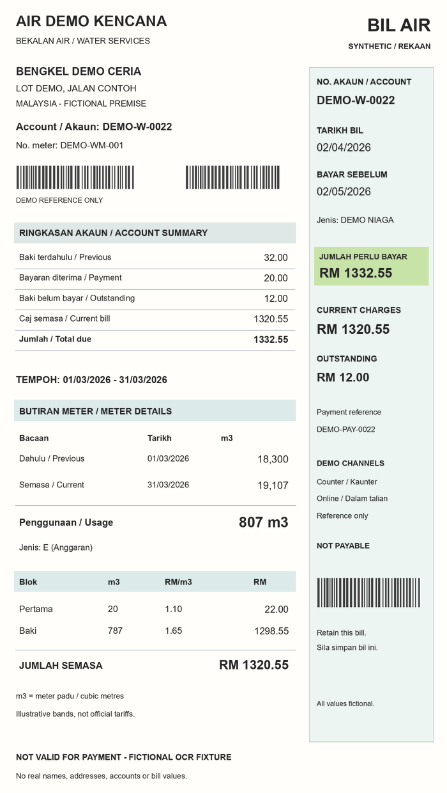
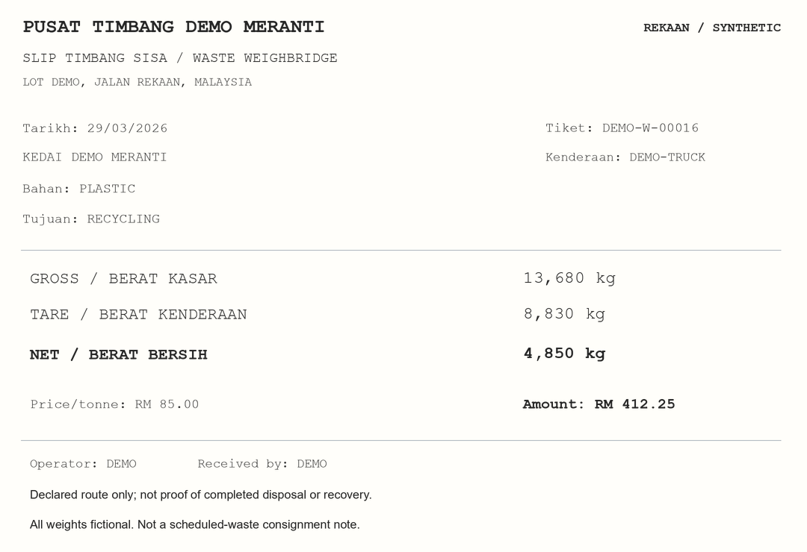
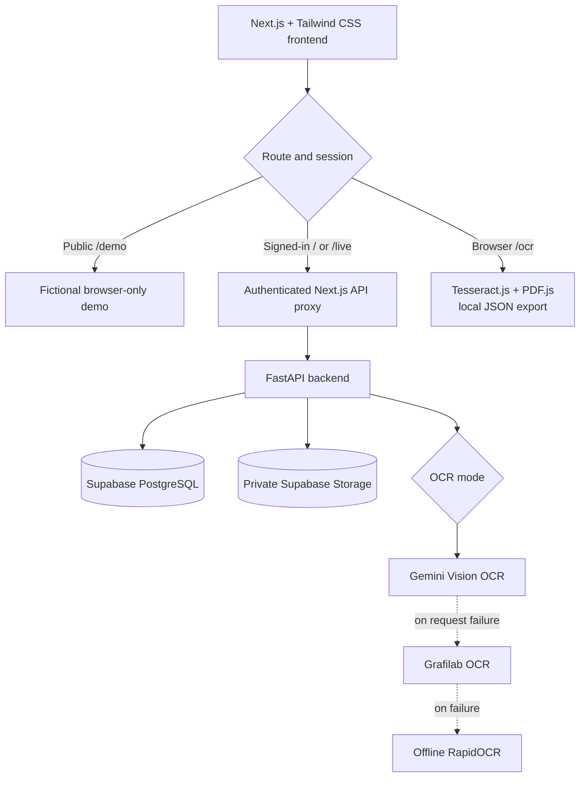

<p align="center">
  
</p>

<h1 align="center">ESG Passport</h1>

<p align="center"><strong>From messy monthly records to evidence-backed ESG answers.</strong></p>

<p align="center">
  An auditable ESG reporting and customer-questionnaire prototype for Malaysian SMEs.
</p>

<p align="center">
  
  
  
  
  
  
  
  
</p>

<p align="center">
  <a href="https://esg-passport-web.onrender.com/">Protected ESG Passport</a> ·
  <a href="https://esg-passport-web.onrender.com/demo">Public fictional demo</a> ·
  <a href="https://esg-passport-web.onrender.com/ocr">Browser OCR</a> ·
  <a href="docs/DEPLOY-RENDER.md">Deployment guide</a>
</p>

---

## The problem

Small and medium-sized enterprises often have electricity bills, water bills, waste records, policy declarations and customer ESG questionnaires spread across different files and months. Turning those fragments into a consistent, supportable disclosure pack takes time—and an apparently complete answer may still lack evidence.

**ESG Passport** brings the process together: collect monthly records, suggest values from documents, check what the evidence actually supports, answer customer questions and require owner approval before sharing.

It is a **hackathon prototype**, not an ESG certification service or an independent assurance opinion.

## What ESG Passport does

| Capability | What happens |
| --- | --- |
| **Monthly evidence intake** | Upload electricity, water, fuel or waste documents and preserve the original source. |
| **AI-assisted OCR** | In the protected workspace, Gemini Vision transcribes documents; Grafilab can be an optional fallback. RapidOCR remains an offline fallback. |
| **Human review** | Check proposed quantities, units, dates and categories against the original before they enter calculations. |
| **ESG profile** | Build month-scoped environmental metrics using confirmed activities and explicit emission-factor policies. |
| **Owner declarations** | Record social and governance responses, supporting evidence and known gaps. |
| **Customer requests** | Paste a customer's questions; deterministic English/Malay SEDG rules suggest disclosure codes for human review. |
| **Evidence matching** | Connect reviewed answers to relevant metrics, reporting periods and available evidence; flag missing coverage. |
| **Approve & share** | The owner acknowledges unresolved limitations and chooses which evidence belongs in a shared snapshot. |
| **Audit-friendly revisions** | Keep source files, changes, approvals and selected evidence traceable. |

### The workflow



**Important:** OCR suggestions do **not** automatically become verified ESG measurements. Unavailable data stays unavailable until someone supplies and reviews appropriate evidence.

## Try the application

| Route | What you can try | Where the data lives |
| --- | --- | --- |
| **[Protected ESG Passport](https://esg-passport-web.onrender.com/)** (`/`) | Sign in as authorized staff; review Supabase records and upload documents using configured Gemini / Grafilab OCR. | Server-side **Supabase PostgreSQL** and **private Supabase Storage**. |
| **[Public fictional demo](https://esg-passport-web.onrender.com/demo)** (`/demo`) | Explore guided sample scenarios without a password or backend account. | Browser-only fictional state; **no Supabase access** or remote AI requests. |
| **[Browser OCR scanner](https://esg-passport-web.onrender.com/ocr)** (`/ocr`) | Extract and review text from images or PDFs locally in your browser; export a JSON review. | Browser only; **does not create a Supabase record**. |

The homepage `/` and optional `/live` use the existing demo-password session. The owner/clerk role switch is **simulated**, not a real multi-user identity system. Only authorized testers should access Supabase.

### Example evidence

These are **fictional test documents**, not personal bills or screenshots of a live customer account.

<p align="center">
  
  &nbsp;&nbsp;
  
  &nbsp;&nbsp;
  
</p>
<p align="center"><em>Electricity · Water · Waste — sample evidence for demonstrating review and traceability.</em></p>

## How AI is integrated

**OCR and questionnaire mapping are separate systems.** They should not be confused with one another.

### Document OCR

Protected staff uploads go to FastAPI. When external OCR is enabled, the backend sends the document image to the configured AI provider and feeds its transcription into a conservative extraction parser. Original evidence is retained and all candidate values require user confirmation.

| Backend mode (`ESG_OCR_MODE`) | Behaviour |
| --- | --- |
| `offline` | Offline RapidOCR only; no document is sent to an AI provider. |
| `gemini` | First Gemini model from `ESG_COMPARE_MODELS`, or the configured single-model default. |
| `gemini_grafilab_fallback` | Try Gemini, then Grafilab if the Gemini request fails, then offline OCR if both are unavailable. |
| `grafilab` | Grafilab OCR, with offline fallback if unavailable. |
| `compare` | Run the first two Gemini models and flag differences between reviewable candidates. |
| `compare_grafilab` | Compare Gemini and Grafilab candidates. |

Provider calls depend on valid server-side credentials, model permissions and quotas. The public `/demo` experience is **entirely fictional and browser-only**; it does not use remote OCR or Supabase. The separate `/ocr` route uses **Tesseract.js / PDF.js in the browser**, not Gemini.

### Customer questionnaire mapping

Customer questions are **not sent to Gemini or Grafilab**. The questionnaire flow uses reviewed, deterministic English/Malay mapping rules (`src/ai/workflow/mapping.py`) to propose applicable SEDG disclosure codes. A staff member confirms each mapping, and answers come from the saved profile, supporting evidence or an explicit owner declaration.

The offline workflow focuses on the supported basic environmental disclosures **E1.1, E1.2, E2.1, E3.1 and E4.1**. Other disclosure requests and unsupported cases need human handling. A confidence label is a rule-based review indicator, **not an LLM probability**.

## Architecture



- **Frontend:** Next.js, React, TypeScript and Tailwind CSS.
- **Backend:** Python, FastAPI, SQLAlchemy, Alembic and Pydantic.
- **Data:** Supabase PostgreSQL for persistent records; a private Storage bucket for original evidence.
- **OCR:** Gemini, optional Grafilab, RapidOCR and standalone browser-based Tesseract.js.
- **Hosting:** two Render web services (frontend and API), deployed from `main`.

## What is real and what is simulated?

| Component | Status / limitation |
| --- | --- |
| Monthly record editing, review, versioned history and owner approval | Implemented application behaviour; calculations use explicitly confirmed data. |
| Supabase persistence | Used by the **signed-in** homepage and `/live`; the public `/demo` never connects to it. |
| Gemini / Grafilab OCR | Real HTTP adapters in the protected backend when configured; availability and accuracy depend on the external providers. |
| Public demo OCR | Fixed fictional examples—not a live AI request or backend document upload. |
| Browser OCR scanner | Real client-side OCR, but its JSON export is **not** automatically imported into the ESG workspace. |
| Customer request mapping | Deterministic, bilingual SEDG rules; **not** a generative AI service. |
| Owner / clerk / customer identities | Simulated roles, guarded by a shared staff demo login in hosted mode; not production authentication. |
| Evidence quality and compliance | Gaps are surfaced; there is no independent source verification, official regulatory submission or certification. |

## Run locally

Requires **Python 3.12**, **Node.js 22**, npm and an appropriately configured **Supabase** project. The detailed first-time setup (database migrations, private Storage initialization and sample seeding) is in the [backend guide](src/backend/README.md).

### 1. Configure the environment

Copy the root template only if you do not already have a private `.env` file:

```powershell
if (!(Test-Path .env)) { Copy-Item .env.example .env }
```

Fill in your backend-only Supabase credentials in the repository-root `.env` file. For local development, the frontend and backend addresses should match:

```dotenv
NEXT_PUBLIC_API_URL=http://127.0.0.1:8001
FRONTEND_ORIGIN=http://127.0.0.1:3000

# Optional remote OCR; disabled by default.
ESG_OCR_MODE=offline
# Configure the applicable server-side API keys and model IDs to enable AI OCR.
```

**Never commit `.env` or place service-role keys, database passwords or AI API keys in `NEXT_PUBLIC_*` variables.** Opting into remote OCR transmits documents to external providers and can incur usage charges.

### 2. Start FastAPI

```powershell
cd src/backend
py -3.12 -m venv .venv
.\.venv\Scripts\python.exe -m pip install -r requirements.txt

# Perform Alembic migrations and explicit storage setup first.
# See src/backend/README.md for the full commands.

.\.venv\Scripts\python.exe -m uvicorn esg_backend.app:app --host 127.0.0.1 --port 8001
```

### 3. Start Next.js in a second terminal

From the repository root:

```powershell
cd src/frontend
npm ci
npm run dev
```

Open **http://127.0.0.1:3000**. Changing the root `.env` requires restarting the affected service(s).

## Tests and verification

```powershell
# From src/frontend
npm test
npm run typecheck
npm run build

# From src/backend, with development dependencies installed
.\.venv\Scripts\python.exe -m pip install -r requirements-dev.txt
.\.venv\Scripts\python.exe -m pytest tests -q --basetemp=./.pytest-tmp

# With the backend configured, verify database and bucket access
.\.venv\Scripts\python.exe -m esg_backend.cli check
```

Most tests use isolated fake or in-memory services; passing them does not prove that real AI quotas, Supabase permissions or the hosted deployment are working. Check those separately, without exposing secrets.

## Deploy

See **[Render deployment instructions](docs/DEPLOY-RENDER.md)** and the root [`render.yaml`](render.yaml). The frontend and API deploy from `main` and may deploy independently.

The protected backend requires its own Supabase configuration; remote OCR additionally requires API keys and `ESG_OCR_MODE`. The local `.env` is **not** automatically copied to Render. Never put private credentials in repository files.

## Project structure

```text
ESG-Passport/
├── src/
│   ├── frontend/                 # Next.js UI, /live and browser /ocr
│   ├── backend/                  # FastAPI, persistence, AI OCR, tests
│   └── ai/
│       ├── workflow/             # Rule-based SEDG mapping and evidence review
│       ├── comparison/           # Separate OCR provider experiment/results
│       └── synthetic_dataset/    # Fictional document fixtures
├── docs/                         # Deployment notes and project mark
├── submission/                   # Hackathon submission materials
├── tests/                        # Offline AI workflow tests
├── render.yaml                   # Render Blueprint configuration
└── .env.example                  # Safe environment variable template
```

## Further reading

- [Backend setup and security](src/backend/README.md)
- [Frontend routes and access modes](src/frontend/README.md)
- [Offline SEDG mapping and review workflow](src/ai/workflow/README.md)
- [OCR model comparison research](src/ai/comparison/README.md)
- [Synthetic sample dataset](src/ai/synthetic_dataset/README.md)
- [Render deployment guide](docs/DEPLOY-RENDER.md)

## Limitations

ESG Passport is a **prototype for demonstration and research**. Its current shared-password protection and simulated roles are not sufficient for a public, multi-tenant product handling confidential company records. Deployments intended for real organizations need individual authentication, authorization, tenant isolation, retention controls, data-processing consent and security review. Automated evidence extraction does not amount to verified ESG compliance.

## License

Licensed under the [Apache License 2.0](LICENSE).
