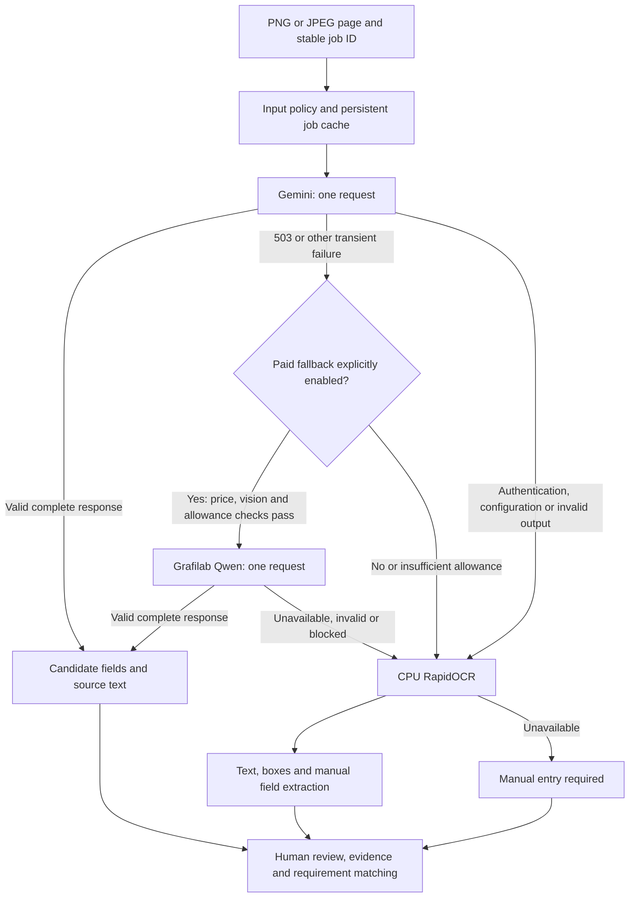

# OCR fallback architecture

The optional OCR component handles a failed Gemini request without silently losing
the document or substituting a fabricated field value. It is callable application
code; the existing backend upload endpoint and UI are **not yet connected** to it.



## Default behaviour

- Gemini remains primary: `gemini-3.5-flash-lite`.
- On 503, 502, 504, 500, 429 or a timeout, it switches to the eligible fallback.
- Default fallback is local CPU RapidOCR. No Grafilab metadata or inference call
  occurs when paid fallback is disabled or its allowance is zero.
- Optional paid chain uses the reviewed vision model
  `grafilab/qwen3.5-397b-a17b`, then RapidOCR if it fails.
- Every result requires human review. A completed cloud response supplies candidate
  fields, not verified disclosures. Local OCR supplies text and boxes only; its
  result is `manual_review`, not successful structured extraction.
- Empty/invalid JSON, schema violations and incomplete model responses cannot be
  passed off as complete results. Authentication/configuration failures go directly
  to local OCR rather than spending on another API.
- Original input bytes are retained by the caller. No random augmentation,
  destructive preprocessing, automatic provider retries or GPU execution is added.

## Reliability controls

`OCRState` stores a private SQLite ledger containing job signatures, final results,
provider attempt state, circuit cooldowns and paid reservations. A repeated completed
job returns its stored result. Changing image bytes, prompt/schema, models, routing
or policy under the same job ID is rejected. Use a server-generated, tenant-scoped
stable ID per document/page/extraction revision; do not accept arbitrary client IDs.

A transient failure opens that provider's circuit for 120 seconds. Other jobs skip
it during cooldown. A new job can probe it after cooldown; the same failed job is
not silently resent. A process killed while an inference outcome is unknown leaves
the job claimed. An operator must inspect the attempt and use an explicitly local
recovery job or manual entry. This intentionally avoids duplicate cloud charges.

Transactions prevent two workers from claiming the same job or oversubscribing
the same local allowance. Create a separate router/SQLite connection per worker;
do not share a connection between threads. Share the ledger path across workers
that consume one allowance. Local disk permissions, backups and retention must be
set by the application; this database is not encrypted or an authentication system.
Distributed hosting requires a shared transactional store rather than separate
per-instance SQLite files. Calls are synchronous and have explicit transport timeouts.

Exception messages, keys and HTTP headers are not copied into failure records.
Successful result caches can contain document text and raw model output, so keep
them in private storage. Circuit/attempt records show the actual selected engine,
status code, timing, skip reason and unknown-cost reservations. These operational
records do not establish source authenticity or human approval.

## Paid fallback policy

The root `.env.example` documents:

```
OCR_FALLBACK_MODE=local
OCR_GRAFILAB_ALLOWANCE_MYR=0
OCR_GRAFILAB_PRICES_CONFIRMED=false
```

Select `grafilab_then_local`, explicitly assign an allowance and confirm the
account's prices before enabling paid fallback. The supported policy is the
user-supplied 23 October 2026 console pricing: MYR1.60/M input and MYR11.00/M output.
Reconfirm it if prices change; the current catalogue does not supply a verified
price in the saved metadata. It must declare vision support and a context length
no greater than the reviewed 128,000-token bound before the image is sent.

The conservative reservation is `(128000*1.60 + 8192*11.00)/1M = RM0.294912` per
potential paid inference. This deliberately over-reserves input/output capacity.
The actual API-reported MYR charge replaces it only after a valid successful result.
Unknown charges and failed/timed-out requests retain their reservation. A subsequent
job cannot exceed the remaining allowance under these assumptions.

This is a **local reservation policy**, not a provider-enforced billing limit or
an audit of the account's remaining RM80. Earlier comparison calls, other API keys
and GPU charges are outside this ledger. Allocate allowance with those expenses
in mind; do not delete/reset the ledger to reuse spent budget. There is no automatic
top-up or paid fallback when configuration or price confirmation is missing.

## Configuration and dependencies

`config.create_router(state_path=...)` reads only this repository's root `.env`;
it does not search parent directories, export keys to the browser, or alter the file.
Supply a private, persistent state path whose parent already exists. No cloud call
happens during construction. Runtime calls still require the team's approved scope.
This competition implementation sends **only explicitly synthetic images** to cloud
providers. Non-synthetic requests go to local OCR. A future production data policy
requires its own provider/privacy review.

Provider packages are optional and lazily imported. `requirements.txt` in this
folder lists the tested SDK/runtime versions; install with uv targeting an explicitly
approved environment. Nothing is installed automatically. RapidOCR requires the
three named local ONNX weight files checked in `providers.py`; if missing, the local
route reports an error instead of downloading them. Weight provisioning requires
separate approval. The generator's Pillow13 environment remains separate from the
backend's Pillow<13 requirement.

Example server-side use, after explicit cloud-run authorisation:

```python
from pathlib import Path
from ai.workflow.ocr.config import create_router

router = create_router(state_path=Path('src/ai/.local/ocr-runtime.sqlite3'))
try:
    result = router.extract(
        'demo-company:document-123:page-1:extraction-v1',
        Path('src/ai/synthetic_dataset/waste/waste-landscape-007-photo.png').read_bytes(),
        mime_type='image/png', synthetic=True,
    )
finally:
    router.close()
```

Cloud fields preserve their OCR labels, units, printed periods and evidence snippets.
They still need semantic conversion into activity observations and boundary review
before `ingest_document`/SEDG matching. A local transcript does not magically supply
those fields. PDF page rendering and this OCR-to-activity review bridge are outside
the component. The compound-water-question mapping issue found in the spot check
is a separate unresolved semantic limitation, not repaired by switching OCR engines.

## Validation and sources

Failure-injection tests exercise 503 routing, no paid escalation without permission,
paid exhaustion/unknown charges, persistent cache, interrupted jobs, cooldown,
invalid outputs and all-engines-failed manual handling. They make no cloud calls.
An offline replay can feed the previously recorded Google503 into the router and
run real local OCR on the same waste image; label that as a replay, not a new
successful Google/Grafilab request.

Primary technical references:
[Google troubleshooting](https://ai.google.dev/gemini-api/docs/troubleshooting),
[Grafilab model API and pricing](https://docs.grafilab.ai/models/),
[Grafilab API quickstart](https://docs.grafilab.ai/models/quickstart/).
